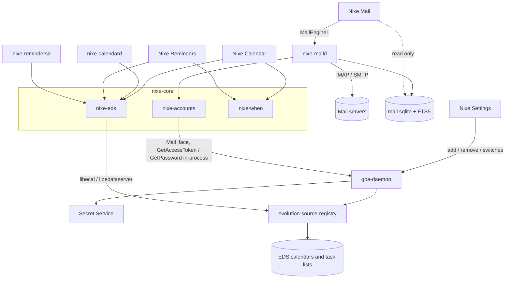

# PIM architecture

Shared foundation for Nixe Mail, Nixe Calendar and Nixe Reminders. Accounts and
security rules are in [../online-accounts/](../online-accounts/README.md); this file
covers what sits on top of them.

## Ownership

| Repository | Owns |
| --- | --- |
| `nixe-core` | `nixe-accounts` (GOA client, mail settings, in-process credentials), `nixe-eds` (EDS calendars and task lists), `nixe-when` (date, time and recurrence parsing), `nixe-sync` (backoff) |
| `nixe-mail` | Mail UI, `nixe-maild` sync engine, mail store and search, Glimpse plugin |
| `nixe-calendar` | Calendar UI, `nixe-calendard` reminders and agenda index, Calendar Sets, scheduling, Glimpse plugin |
| `nixe-reminders` | Reminders UI, `nixe-remindersd` due alerts, smart lists and sidecar metadata, Glimpse plugin |
| `nixe-settings` | Account add, sign-in, removal and service switches (GOA helper) |
| `nixe-contacts` | Contacts; lookup for other apps through its Control tools |

Apps depend on `nixe-core` and `nixe-design` only. No app opens another app's database
or links another app's crates. There is no PIM daemon: GOA owns accounts, EDS owns
calendar and task sync, and each app owns its own data.

## Data

| Data | Owner | Where |
| --- | --- | --- |
| Accounts, tokens, passwords | GOA | `~/.config/goa-1.0`, Secret Service |
| Events, task lists, offline queue | EDS | `~/.config/evolution/sources`, `~/.cache/evolution` (never edited by Nixe) |
| Mail messages, flags, search, sender rules, ops queue | Nixe Mail | `~/.local/share/nixe-mail/` |
| Calendar Sets, working hours, agenda snapshot | Nixe Calendar | `~/.local/share/nixe-calendar/` |
| Flags, tags, manual order, mail links for reminders | Nixe Reminders | `~/.local/share/nixe-reminders/reminders.sqlite`, keyed by EDS uid |

Nixe stores no credentials. Directories holding mail are created with mode 0700.

## Why mail is not in EDS

The earlier decision was to use Camel. That decision is replaced:

- Camel is an in-process library with no D-Bus API and no Rust bindings. A client
  must subclass `CamelSession` to supply passwords and OAuth tokens.
- Camel keeps mail in Evolution's private cache, which Nixe must not touch. Search,
  the Screener and sender rules would still need a Nixe database next to it.
- GOA already provides everything a native client needs. The `Mail` interface
  gives hosts, TLS, user name and whether XOAUTH2 applies, and `OAuth2` / `Password`
  give credentials in-process. The live Google account exposes `imap.gmail.com` and
  `smtp.gmail.com` with XOAUTH2.

So Mail uses a native Rust IMAP/SMTP engine (`nixe-maild`) that fetches credentials
from GOA on each connection and never stores them. Microsoft 365 (`ms_graph`) has no
IMAP settings in GOA; it gets a Graph adapter after the first release.

## Why calendars and tasks are in EDS

EDS already does CalDAV, Google and (with `evolution-ews`) Microsoft sync, offline
caching, an offline change queue and ETag conflicts. libecal and libical give
recurrence expansion, time zones and alarm tracking (`EReminderWatcher`). Neither
library links gtk3 or WebKit.

`nixe-eds` binds them through GObject introspection: generated `-sys` crates for
EDataServer-1.2, ECal-2.0 and ICalGLib-4.0 (EDS 3.62), committed to the repository,
under a small hand-written safe API covering only what the apps use. This replaces the
private EDS D-Bus protocol for calendars; Contacts' existing address-book reads in
`nixe-accounts::eds` are unchanged.

## Credentials (`nixe-accounts`, feature `credentials`)

- `mail_settings(&Account)` reads the `Mail` interface. No secrets.
- `access_token(&Account)` and `password(&Account, id)` call GOA in-process and return
  a redacted `Secret`. Callers use it for one connection and drop it.
- Not exported on any Nixe bus name, not logged, not written to disk
  ([SECURITY.md](../online-accounts/SECURITY.md) rules 1, 2 and 5).
- Settings and Contacts do not enable the feature.

On an authentication failure an app calls `ensure_credentials`. If GOA then reports
`AttentionNeeded`, the app shows a banner whose action opens Settings → Online
Accounts.

## Interfaces

| Interface | Where | For |
| --- | --- | --- |
| `io.github.design_nexus.nixe.Control` | Mail, Calendar and Reminders app ids | Assistant and other apps (`nixe_core::control`) |
| `io.github.design_nexus.nixe.MailEngine1` | `nixe-maild` | Mail UI only; versioned, private to `nixe-mail` |
| `io.github.design_nexus.nixe.CalendarEngine1` | `nixe-calendard` | `Agenda`, `FreeBusy`, `QuickCreate` |
| Read-only SQLite snapshots | `mail.sqlite`, `agenda.sqlite`, `today.sqlite` | Glimpse plugins; schema is a contract recorded in `suite.toml` |

No interface returns tokens or passwords.

## Providers

| Provider | Mail | Calendar | Reminders |
| --- | --- | --- | --- |
| Google | IMAP/SMTP, XOAUTH2 | EDS CalDAV | EDS Google Tasks |
| IMAP and SMTP (Fastmail, iCloud, others) | IMAP/SMTP, password | | |
| WebDAV (Nextcloud, Fastmail, iCloud) | | EDS CalDAV | EDS CalDAV VTODO |
| Microsoft 365 | Graph adapter, later | EDS with `evolution-ews`, later | |
| This computer | | EDS local calendar | EDS local task list |

## Known EDS behavior (3.62)

Found while testing `nixe-eds` against a real EDS; the workarounds are in the crate.

- `e_cal_client_connect_sync` treats a wait of 0 seconds as "wait forever".
  `Calendar::open` takes `Option<u32>`; `None` passes `(guint32) -1`, which means don't wait.
- EDS identifies an occurrence by its RECURRENCE-ID text as EDS wrote it (UTC for
  expanded instances). Changing one occurrence needs the master detached into it
  (DTSTART moved, rules dropped), and the RECURRENCE-ID text must be kept as is.
- The local file backend ("On this computer") leaves a changed occurrence out of its
  time index (`e-cal-backend-file.c`, `E_CAL_OBJ_MOD_THIS`), so range queries miss it
  until EDS restarts. For local calendars `Calendar::instances` expands each matching
  item from all of its components instead. CalDAV and Google calendars use EDS's
  cache and are not affected. Worth reporting upstream.
- A time read from a lone component has no zone and doesn't report its TZID; the
  TZID is a parameter on the property. `nixe-eds` reads that parameter and resolves it
  through libical's built-in zones, then the calendar's own stored zones.
- Importing a file whose VTIMEZONE the local calendar already has makes
  `evolution-calendar-factory` abort inside libical (`icalcomponent_merge_component`).
  `Calendar::import_all` drops zones the calendar already knows before importing.
  Worth reporting upstream.
- `EReminderWatcher` signal handlers must be disconnected before the watcher goes:
  EDS can drop its last reference on another thread. `Reminders` does this on drop.
